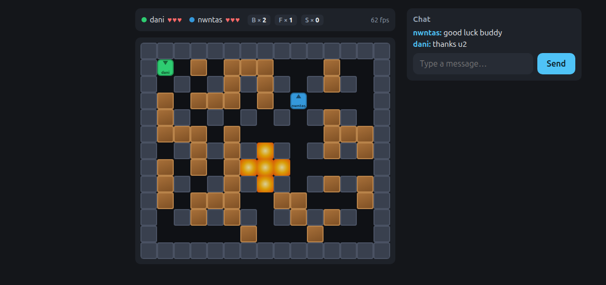

# Bomberman-Dom

Multiplayer Bomberman for **2–4 players** — pure DOM, **no canvas, no WebGL** —
built on a from-scratch mini-framework and a WebSocket authoritative server.



## Play

```bash
npm install
npm start            # http://localhost:3001
```

Open **2–4 tabs or windows**, pick a nickname and battle until one player is
left standing. The chat keeps everyone talking in real time.

> Default port is 3001; override with `PORT=8080 npm start`.

## Controls

| Action       | Keys           |
| ------------ | -------------- |
| Move         | WASD or arrows |
| Place a bomb | Space          |
| Send a chat  | Type + Enter   |

## Gameplay

- **Arena:** 15×13 tiles, always fully visible. Indestructible walls and
  random destructible blocks; players spawn in the four corners.
- **Lives:** 3 per player. Caught in an explosion you respawn with a short
  invulnerability; at 0 lives you are out. Last one standing wins.
- **Power-ups** drop when a block explodes: **Bombs** (+1 bomb at once),
  **Flames** (+1 explosion range), **Speed** (+1 movement speed).
- **Bombs** explode in a cross after 2 seconds, destroy blocks, chain-react,
  and hurt anyone in range — including you.

## Performance check (audit)

The board runs at 60 fps from a single `requestAnimationFrame` loop that moves
sprites with `transform: translate3d` (compositor-only, minimal paint). To
verify it yourself in Chrome DevTools:

1. Open **Performance**, press **Record**, play a match for ~10 s.
2. Expect **no long tasks** and the frame chart holding ~60 fps.
3. **Rendering** → enable _Paint flashing_: only moving sprites should flash.
4. Enable _Layer borders_: only moving sprites (players, bombs, flames) get
   borders — the tiles never do.

## Scripts

| Command                                   | Purpose                                        |
| ----------------------------------------- | ---------------------------------------------- |
| `npm start`                               | server: static files + WebSocket on :3001      |
| `npm dev`                                 | same, auto-restarts on change (`node --watch`) |
| `npm test`                                | `node:test` suite (map, lobby, match)          |
| `npm run lint` / `npm run lint:fix`       | ESLint (flat config)                           |
| `npm run format` / `npm run format:check` | Prettier                                       |

## Manual test checklist

**Lobby — 2 players**

1. Two tabs join → the counter goes `1/4` → `2/4` and both see each other.
2. Send a message in one tab → it appears instantly in the other.
3. After the 20 s window, the 10 s countdown starts (with two players).

**Lobby — 4 players**

4. Two more tabs join → counter `4/4` → the 10 s countdown starts immediately.

**Match**

5. Move and plant bombs; explosions destroy blocks and spawn power-ups.
6. Standing in your own explosion costs a life; a player at 0 lives is out.
7. When one player survives, the game-over screen shows the winner and the
   lobby reopens for the next round.

## Architecture (short)

```
framework/   vendored mini-framework — UNMODIFIED, do not edit
shared/      pure logic shared by client + server (ESM, no DOM)
client/      mini-framework screens + one rAF game loop (direct DOM)
server/      Node + ws: static files + authoritative simulation
tests/       node:test suites (map, lobby, match)
```

- **Two rendering layers:** the mini-framework drives screens and flow; a single
  `requestAnimationFrame` loop owns the board, moving entities with
  `transform: translate3d`. Per-frame state never goes through `setState`.
- **Authoritative server:** owns the simulation, consumes inputs and broadcasts
  30 Hz snapshots; clients interpolate for smooth 60 fps rendering.

See [PLAN.md](./PLAN.md) for the full implementation plan and audit mapping, and
[docs/specs/netcode-timings.md](./docs/specs/netcode-timings.md) for the
simulation/interpolation decision.
